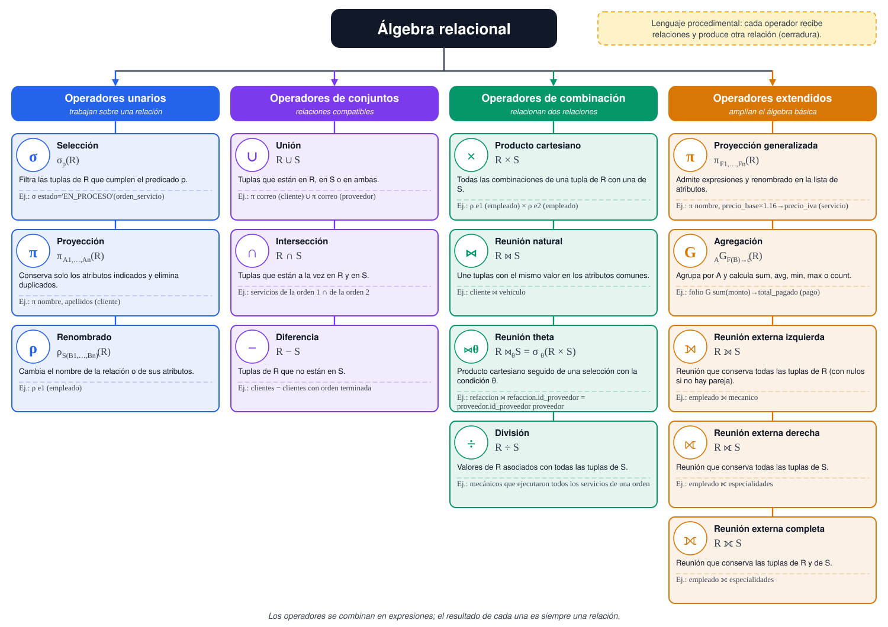

# Tarea 5.1: Operadores del álgebra relacional básica y extendida

**Unidad 5:** Álgebra relacional  
**Materia:** Fundamentos de Base de Datos  
**Alumno(a):** Kevin Anselmo Orozco Aguayo (matrícula I24050540)  
**Docente:** Rubén Riojas  
**Fecha de entrega:** 10 de noviembre de 2026

---

## Introducción

El álgebra relacional es el lenguaje formal sobre el que se construyen los lenguajes de consulta de las bases de datos relacionales, como SQL. Describe, mediante operadores matemáticos, cómo obtener nueva información a partir de las relaciones (tablas) existentes (Codd, 1970). Comprenderla permite escribir consultas correctas y entender cómo las procesa un sistema gestor de bases de datos.

Este documento presenta el marco conceptual del álgebra relacional: la notación formal y el significado de los operadores unarios (selección, proyección y renombrado) y binarios (unión, intersección, diferencia, producto cartesiano, reunión y división), así como los operadores del álgebra extendida (proyección generalizada, funciones de agregación y reuniones externas). Los ejemplos se resuelven sobre el esquema relacional del taller automotriz del proyecto, con los datos de prueba de la base de datos.

## 1. Marco conceptual

### 1.1 Relaciones y consultas

Una relación r(R) sobre un esquema R(A1,…,An) es un conjunto de tuplas; por ello no admite tuplas repetidas y el orden de las filas carece de importancia (Elmasri & Navathe, 2016). Una consulta en álgebra relacional es una expresión formada por operadores que se aplican a una o más relaciones.

### 1.2 Propiedad de cerradura

El resultado de cualquier operador es otra relación. Esta propiedad, llamada cerradura, permite componer los operadores y anidar expresiones: el resultado de una consulta puede ser el operando de otra (Silberschatz et al., 2020). Las expresiones se evalúan de adentro hacia afuera, generando tablas intermedias.

### 1.3 Notación

La Tabla 1 resume los operadores estudiados. En las expresiones, R y S representan relaciones, p es un predicado (condición), Ai son atributos y θ es una condición de reunión.

*Tabla 1. Operadores del álgebra relacional y su notación*

| Operador | Símbolo | Notación formal | Tipo |
|---|---|---|---|
| Selección | σ | σp(R) | Unario |
| Proyección | π | πA1,…,An(R) | Unario |
| Renombrado | ρ | ρS(B1,…,Bn)(R) | Unario |
| Unión | ∪ | R ∪ S | Binario (conjuntos) |
| Intersección | ∩ | R ∩ S | Binario (conjuntos) |
| Diferencia | − | R − S | Binario (conjuntos) |
| Producto cartesiano | × | R × S | Binario |
| Reunión theta | ⋈θ | R ⋈θ S | Binario |
| Reunión natural | ⋈ | R ⋈ S | Binario |
| División | ÷ | R ÷ S | Binario |
| Proyección generalizada | π | πF1,…,Fn(R) | Extendido |
| Agregación | G | A1,…,AkGF1(B1) → c1,…(R) | Extendido |
| Reunión externa izquierda | ⟕ | R ⟕ S | Extendido |
| Reunión externa derecha | ⟖ | R ⟖ S | Extendido |
| Reunión externa completa | ⟗ | R ⟗ S | Extendido |

## 2. Operadores unarios

### 2.1 Selección (σ)

La selección extrae de una relación las tuplas que cumplen un predicado. Su definición formal es:

σp(R) = { t | t ∈ R ∧ p(t) }

El predicado p se forma con comparaciones (=, ≠, <, >, ≤, ≥) entre atributos y constantes, combinadas con los conectores ∧ (y), ∨ (o) y ¬ (no). El resultado tiene el mismo esquema que R y, como máximo, el mismo número de tuplas. La selección es conmutativa: σp1(σp2(R)) = σp2(σp1(R)) = σp1 ∧ p2(R).

**Ejemplo.** Órdenes de servicio en proceso:

σestado='EN_PROCESO'(orden_servicio)

*Tabla 2. Resultado de σ estado='EN_PROCESO' (orden_servicio)*

| folio | fecha_ingreso | fecha_entrega | estado | num_serie | id_recepcionista |
|---|---|---|---|---|---|
| 3 | 2026-10-28 | NULL | EN_PROCESO | JT2AE86S3F0123456 | 1 |

### 2.2 Proyección (π)

La proyección conserva solo los atributos indicados y elimina las tuplas duplicadas que resulten:

πA1,…,An(R) = { t[A1,…,An] | t ∈ R }

**Ejemplo.** Métodos de pago utilizados. La tabla pago tiene cuatro filas, pero el método TARJETA aparece dos veces; el resultado lo muestra una sola vez porque una relación es un conjunto:

πmetodo_pago(pago)

*Tabla 3. Resultado de π metodo_pago (pago)*

| metodo_pago |
|---|
| EFECTIVO |
| TARJETA |
| TRANSFERENCIA |

### 2.3 Renombrado (ρ)

El renombrado asigna un nuevo nombre a una relación o a sus atributos, lo que permite referirse a la misma relación dos veces en una expresión (por ejemplo, en un producto cartesiano de una tabla consigo misma):

ρS(B1,…,Bn)(R)      ρx(R)

La expresión ρe1(empleado) crea una copia de empleado llamada e1, cuyos atributos se distinguen como e1.nombre, e1.salario, etc.

## 3. Operadores binarios

### 3.1 Unión, intersección y diferencia

Estos operadores requieren que las relaciones sean **compatibles**: mismo número de atributos y dominios correspondientes. Se definen como operaciones de conjuntos:

R ∪ S = { t | t ∈ R ∨ t ∈ S }

R ∩ S = { t | t ∈ R ∧ t ∈ S }

R − S = { t | t ∈ R ∧ t ∉ S }

La unión y la intersección son conmutativas y asociativas; la diferencia no lo es. **Ejemplo de unión.** Todos los correos registrados, de clientes y de proveedores:

πcorreo(cliente) ∪ πcorreo(proveedor)

*Tabla 4. Resultado de la unión de correos*

| correo |
|---|
| juan.perez@example.com |
| maria.lopez@example.com |
| luis.hernandez@example.com |
| ventas@autopartesnorte.example.com |
| contacto@lubrifiltros.example.com |

**Ejemplo de intersección y diferencia.** Sean A = πid_servicio(σfolio=1(detalle_servicio)) = {1} y B = πid_servicio(σfolio=2(detalle_servicio)) = {1, 2}. Entonces A ∩ B es el servicio 1 (el único realizado en ambas órdenes) y B − A es el servicio 2 (realizado solo en la orden 2):

*Tabla 5. Resultado de A ∩ B*

| id_servicio |
|---|
| 1 |

*Tabla 6. Resultado de B − A*

| id_servicio |
|---|
| 2 |

### 3.2 Producto cartesiano (×)

Combina cada tupla de R con cada tupla de S. Los atributos de R y S deben tener nombres distintos (si no, se usa ρ):

R × S = { (r, s) | r ∈ R ∧ s ∈ S }

Si R tiene n atributos y a tuplas, y S tiene m atributos y b tuplas, el resultado tiene n + m atributos y a·b tuplas. **Ejemplo.** πid_servicio(servicio) × πid_proveedor(proveedor) produce 3 × 2 = 6 tuplas:

*Tabla 7. Resultado del producto cartesiano*

| id_servicio | id_proveedor |
|---|---|
| 1 | 1 |
| 1 | 2 |
| 2 | 1 |
| 2 | 2 |
| 3 | 1 |
| 3 | 2 |

### 3.3 Reunión (⋈)

La **reunión theta** es un producto cartesiano seguido de una selección con la condición θ. Cuando θ es una igualdad se llama *equirreunión*; la **reunión natural** iguala automáticamente los atributos que tienen el mismo nombre en ambas relaciones y conserva una sola copia de ellos:

R ⋈θ S = σθ(R × S)

R ⋈ S = πA(R) ∪ A(S)(σR.C = S.C(R × S)),   C = atributos comunes

**Ejemplo de reunión natural.** Cliente y placa de sus vehículos; ambas relaciones comparten el atributo id_cliente:

πnombre, apellidos, placa(cliente ⋈ vehiculo)

*Tabla 8. Resultado de π nombre, apellidos, placa (cliente ⋈ vehiculo)*

| nombre | apellidos | placa |
|---|---|---|
| Juan Carlos | Pérez Gómez | ABC-123-A |
| María Fernanda | López Ruiz | XYZ-456-B |
| Luis Alberto | Hernández Soto | DEF-789-C |

**Ejemplo de reunión theta.** Refacciones con su proveedor, con la condición θ: r.id_proveedor = p.id_proveedor:

πr.nombre, p.razon_social(ρr(refaccion) ⋈r.id_proveedor = p.id_proveedor ρp(proveedor))

*Tabla 9. Resultado de la reunión theta*

| nombre | razon_social |
|---|---|
| Filtro de aceite | Lubricantes y Filtros S.A. |
| Aceite 5W-30 (1 litro) | Lubricantes y Filtros S.A. |
| Balatas delanteras | AutoPartes del Norte S.A. de C.V. |
| Bujía | AutoPartes del Norte S.A. de C.V. |

### 3.4 División (÷)

La división se usa en consultas con la idea de «para todos». Sean R(Z) y S(Y) con Y ⊆ Z y X = Z − Y. Entonces R ÷ S contiene los valores de X que están asociados en R con *todas* las tuplas de S:

R ÷ S = { t | t ∈ πX(R) ∧ ∀ s ∈ S : (t, s) ∈ R }

R ÷ S = πX(R) − πX((πX(R) × S) − R)

**Ejemplo.** Mecánicos que han ejecutado todos los servicios de la orden 2. El dividendo es πid_empleado, id_servicio(ejecucion) y el divisor es πid_servicio(σfolio=2(detalle_servicio)) = {1, 2}. Solo el mecánico 2 está asociado con los servicios 1 y 2:

πnombre(empleado ⋈ (πid_empleado, id_servicio(ejecucion) ÷ πid_servicio(σfolio=2(detalle_servicio))))

*Tabla 10. Resultado de la división*

| nombre |
|---|
| Roberto Díaz |

## 4. Álgebra relacional extendida

### 4.1 Proyección generalizada

La proyección generalizada permite que la lista de atributos incluya expresiones aritméticas y renombrado (Silberschatz et al., 2020):

πF1,…,Fn(R),   donde cada Fi es un atributo o una expresión con atributos y constantes

**Ejemplo.** Precio de cada servicio con IVA del 16 %:

πnombre, precio_base, precio_base × 1.16 → precio_con_iva(servicio)

*Tabla 11. Resultado de la proyección generalizada*

| nombre | precio_base | precio_con_iva |
|---|---|---|
| Cambio de aceite y filtro | 350.00 | 406.00 |
| Afinación mayor | 1200.00 | 1392.00 |
| Cambio de balatas | 500.00 | 580.00 |

### 4.2 Funciones de agregación (G)

El operador de agregación agrupa las tuplas por los atributos G1,…,Gk y calcula funciones de agregación sobre cada grupo. Las funciones disponibles son sum, avg, min, max y count. Si no se indican atributos de agrupamiento, toda la relación forma un solo grupo:

G1,…,GkGF1(A1) → c1,…,Fm(Am) → cm(R)

**Ejemplo con agrupamiento.** Total pagado en cada orden:

folioGsum(monto) → total_pagado(pago)

*Tabla 12. Resultado de la agregación por folio*

| folio | total_pagado |
|---|---|
| 1 | 850.00 |
| 2 | 1870.00 |
| 3 | 500.00 |

**Ejemplo sin agrupamiento.** Número de pagos, ingreso total y pago promedio:

Gcount(num_pago) → num_pagos, sum(monto) → ingresos_totales, avg(monto) → pago_promedio(pago)

*Tabla 13. Resultado de la agregación sin agrupamiento*

| num_pagos | ingresos_totales | pago_promedio |
|---|---|---|
| 4 | 3220.00 | 805.00 |

### 4.3 Reuniones externas (⟕, ⟖, ⟗)

La reunión natural descarta las tuplas que no tienen pareja. Las reuniones externas las conservan, completando con valores nulos (NULL) los atributos de la otra relación:

- **Reunión externa izquierda (R ⟕ S):** conserva todas las tuplas de R.
- **Reunión externa derecha (R ⟖ S):** conserva todas las tuplas de S.
- **Reunión externa completa (R ⟗ S):** conserva las tuplas de ambas relaciones.

R ⟕ S = (R ⋈ S) ∪ { (r, null,…,null) | r ∈ R sin pareja en S }

**Ejemplo.** Sean E = πid_empleado, nombre(empleado), con 4 empleados, y M(id_empleado, especialidad), una relación ilustrativa que incluye al empleado 5, aún no registrado en empleado. Las tres reuniones externas producen:

*Tabla 14. Resultado de E ⟕ M*

| id_empleado | nombre | especialidad |
|---|---|---|
| 1 | Ana Torres | NULL |
| 2 | Roberto Díaz | Motor y transmisión |
| 3 | Carlos Mendoza | Frenos y suspensión |
| 4 | Laura Ramírez | NULL |

*Tabla 15. Resultado de E ⟖ M*

| id_empleado | nombre | especialidad |
|---|---|---|
| 2 | Roberto Díaz | Motor y transmisión |
| 3 | Carlos Mendoza | Frenos y suspensión |
| 5 | NULL | Pintura y carrocería |

*Tabla 16. Resultado de E ⟗ M*

| id_empleado | nombre | especialidad |
|---|---|---|
| 1 | Ana Torres | NULL |
| 2 | Roberto Díaz | Motor y transmisión |
| 3 | Carlos Mendoza | Frenos y suspensión |
| 4 | Laura Ramírez | NULL |
| 5 | NULL | Pintura y carrocería |

## 5. Mapa conceptual de los operadores

La Figura 1 clasifica los operadores en unarios, de conjuntos, de combinación y extendidos. Para cada uno se indican su símbolo, su notación formal, su significado y un ejemplo del taller. El archivo vectorial (SVG) y las exportaciones en PNG y PDF se incluyen en el repositorio.

*Figura 1. Mapa conceptual de los operadores del álgebra relacional. Elaboración propia.*

## 6. Equivalencias útiles

- σp1 ∧ p2(R) = σp1(σp2(R)): una selección compuesta puede dividirse en una cascada de selecciones.
- σθ(R × S) = R ⋈θ S: la reunión theta es un producto seguido de una selección.
- La reunión natural es conmutativa y asociativa; la diferencia y la división no lo son.
- R ∩ S = R − (R − S): la intersección puede expresarse con la diferencia.
- La división se expresa con proyección, producto y diferencia (sección 3.4); por eso no es un operador primitivo.
- Los sistemas gestores usan estas equivalencias para optimizar consultas, por ejemplo aplicando las selecciones lo antes posible para reducir el tamaño de las tablas intermedias.

## 7. Conclusiones

El álgebra relacional proporciona un conjunto pequeño de operadores con una semántica precisa: la selección y la proyección filtran filas y columnas; la unión, la intersección y la diferencia operan como conjuntos; el producto cartesiano y la reunión combinan relaciones; y la división resuelve consultas de tipo «para todos». Gracias a la cerradura, estos operadores se componen para formar consultas arbitrariamente complejas.

Las extensiones (proyección generalizada, agregación y reuniones externas) amplían su capacidad para realizar cálculos, resúmenes y consultas que conservan filas sin pareja, y corresponden a las funciones de SQL como SUM, GROUP BY y LEFT JOIN. En la Tarea 5.2 se aplican estos conceptos a un catálogo de consultas sobre la base de datos del taller.

## Referencias

Codd, E. F. (1970). A relational model of data for large shared data banks. *Communications of the ACM, 13*(6), 377–387. https://doi.org/10.1145/362384.362685  
Date, C. J. (2004). *An introduction to database systems* (8.ª ed.). Pearson Education.  
Elmasri, R., & Navathe, S. B. (2016). *Fundamentals of database systems* (7.ª ed.). Pearson.  
Silberschatz, A., Korth, H. F., & Sudarshan, S. (2020). *Database system concepts* (7.ª ed.). McGraw-Hill Education.  
